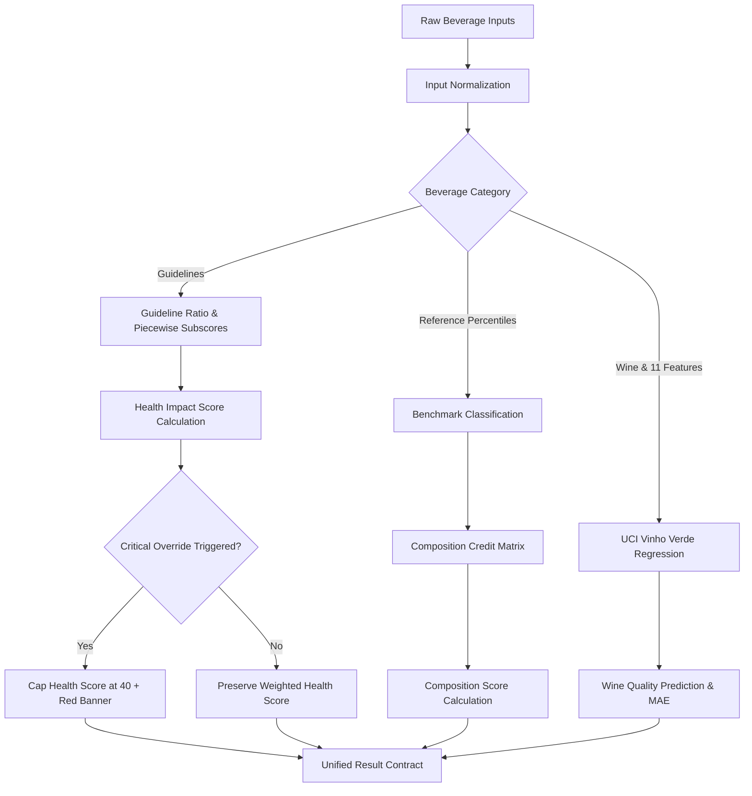

# Beverage Quality Analysis System (BQAS) — Scoring Engine Specification

**Document Version:** 1.0.0  
**Status:** Approved & Implemented  
**Date:** October 2026  
**Reference:** BQAS Product Requirements Document (PRD), Section 12 & Section 13

---

## 1. Architectural Overview

The BQAS Scoring Engine is a pure, deterministic, side-effect-free analysis engine implemented in Python (FastAPI/Pydantic). It evaluates non-alcoholic and alcoholic beverages based on published dietary guidelines (WHO, EFSA, FDA, JECFA/Codex), empirical reference distributions ($n \ge 100$), and machine-learning models (UCI Wine Quality).

### Core Design Principles
1. **Determinism:** Pure functions with explicit tolerances, no hidden stochastic processes.
2. **Strict Score Separation:** **Health Impact Score** and **Composition Score** are calculated independently and are never averaged, merged, or substituted for one another.
3. **Null Preservation:** Missing or blank fields are preserved as `None`/`null`. Missing values are **never** treated or imputed as zero ($0$).
4. **Configuration Centralization:** All thresholds, weights, piecewise curve slopes, conversion constants, and provenance citations reside in external configuration files:
   - `backend/data/rules.json`: Guideline limits, risk directions, weights, and critical rules.
   - `backend/data/reference_ranges.json`: Empirical benchmark percentile distributions ($P_5, P_{25}, P_{50}, P_{75}, P_{95}$) and sample counts.

---

## 2. Input Normalization & Physical Calculations

### 2.1 Serving Size & Unit Handling
- Serving size ($V$) in milliliters ($\text{mL}$) must be strictly positive ($V > 0$). Serving sizes $> 5000\text{ mL}$ generate plausible-bounds warnings.
- Quantities provided per $100\text{ mL}$ or per serving are converted deterministically:
  $$\text{amount}_{\text{serving}} = \text{amount}_{100\text{ml}} \times \frac{V_{\text{serving}}}{100}$$
  $$\text{amount}_{100\text{ml}} = \text{amount}_{\text{serving}} \times \frac{100}{V_{\text{serving}}}$$

### 2.2 Ethanol Mass & Standard Drinks
- **Alcohol Mass Calculation:**
  $$\text{alcohol\_grams} = V_{\text{serving}} \times \frac{\text{ABV}}{100} \times 0.789$$
  *(Ethanol density constant: $0.789\text{ g/mL}$ at $20^\circ\text{C}$)*
- **Standard Drinks Calculation:**
  $$\text{standard\_drinks} = \frac{\text{alcohol\_grams}}{\text{standard\_drink\_grams}}$$
  *(WHO standard drink default: $10.0\text{ g}$; customizable to US $14.0\text{ g}$ or UK $8.0\text{ g}$)*

### 2.3 Sodium Benzoate to Benzoic Acid Equivalent
- Preservative E211 (sodium benzoate) is normalized to active benzoic acid equivalent using the molecular weight ratio factor ($0.848$):
  $$\text{benzoic\_acid\_equivalent\_mg} = \text{sodium\_benzoate\_mg} \times 0.848$$

---

## 3. Benchmark Classification & Empirical Distributions

Benchmark comparisons compare beverage nutrient concentrations against empirical distributions derived from Open Food Facts, USDA FoodData Central, and UCI Wine Quality.

### 3.1 Minimum Data Reliability Threshold ($n \ge 100$)
A benchmark distribution is treated as reliable **only** when its sample size $n \ge 100$. If $n < 100$, the engine returns status `"limited_benchmark_data"` and does not invent synthetic percentiles or credits.

### 3.2 Percentile Classification Boundaries
| Percentile Interval | Benchmark Status | Band Label |
|---|---|---|
| $\text{value} < P_{25}$ | `lower_than_typical` | `< P25` |
| $P_{25} \le \text{value} \le P_{75}$ | `typical` | `P25 - P75` |
| $P_{75} < \text{value} \le P_{95}$ | `higher_than_typical` | `P75 - P95` |
| $\text{value} > P_{95}$ | `very_high` | `> P95` |

*Boundary Note:* Any value strictly above $P_{95}$ is categorized as `very_high` (never merely `higher_than_typical`).

---

## 4. Guideline Ratios & Piecewise Subscore Curve

For high-is-bad and both-direction ingredients, the guideline ratio $r$ is:
$$r = \frac{\text{amount\_per\_serving}}{\text{applicable\_guideline\_limit}}$$

### 4.1 Exact Piecewise Scoring Curve
The engine evaluates $r$ through the 5-band piecewise function specified in PRD Section 12.4:

| Guideline Ratio ($r$) | Band Classification | Subscore Formula | Subscore Range |
|---|---|---|---|
| $r \le 0.5$ | **Favourable** | $100.0$ | $100.0$ |
| $0.5 < r \le 1.0$ | **Moderate** | $100.0 - (r - 0.5) \times 80.0$ | $100.0 \rightarrow 60.0$ |
| $1.0 < r \le 2.0$ | **Caution** | $60.0 - (r - 1.0) \times 40.0$ | $60.0 \rightarrow 20.0$ |
| $2.0 < r \le 3.0$ | **High** | $20.0 - (r - 2.0) \times 20.0$ | $20.0 \rightarrow 0.0$ |
| $r > 3.0$ | **High** | $0.0$ | $0.0$ |

*Tolerances:* Evaluated using floating-point tolerance $\epsilon = 10^{-9}$ at boundaries ($r = 0.5, 1.0, 2.0, 3.0$).

---

## 5. Separate Health and Composition Scores

### 5.1 Health Impact Score
- Weighted mean of guideline subscores for available ingredients:
  $$\text{Raw Health Score} = \frac{\sum_{i \in \text{Available}} (\text{subscore}_i \times w_i)}{\sum_{i \in \text{Available}} w_i}$$
- Missing fields are excluded from both the numerator and denominator.
- Information-only ingredients (e.g. taurine, vitamins) are excluded from the Health Impact Score.
- If no guideline fields are provided, Health Impact Score is `None`.

### 5.2 Composition Score
- Calculated as the unweighted mean of composition credits from benchmark percentiles:
  $$\text{Composition Score} = \frac{\sum \text{credit}_j}{N_{\text{evaluated\_benchmarks}}}$$
- **Credit Assignment Matrix (PRD Section 12.7):**
  - `typical`: $100$
  - `lower_than_typical`: $100$ if risk direction is `high_is_bad`; otherwise $60$.
  - `higher_than_typical`: $50$ if risk direction is `high_is_bad`; otherwise $100$.
  - `very_high`: $20$ if risk direction is `high_is_bad`; otherwise $0$.
  - `limited_benchmark_data` or `info_only`: `None` (omitted from average).

---

## 6. Critical Overrides

Critical overrides intervene when severe toxicological or acute health thresholds are exceeded.

### 6.1 Trigger Conditions
1. **Methanol Limit Breach:** Methanol $> 10.0\text{ g/L}$ of pure alcohol (EU Regulation 2019/787).
2. **Acute Caffeine Single-Dose Breach:** Caffeine per serving $>$ user profile single-dose threshold (e.g. $> 200\text{ mg}$ for adults, or exceeding weight-scaled limit for minors).

### 6.2 Override Action
- Health Impact Score is capped at maximum $40.0$:
  $$\text{Health Impact Score} = \min(\text{Raw Health Score}, 40.0)$$
- Underlyling raw score is preserved as `uncapped_health_impact_score` for clinical auditability.
- Structured critical metadata returned: `banner_color: "red"`, `is_critical: True`, and explanatory warning messages.
- Composition Score is **not** modified by the critical override.

---

## 7. Personalization & Limit Scaling

| Target Group | Nutrient | Applicable Limit | Regulatory Source |
|---|---|---|---|
| **Adult** | Caffeine (Single dose) | $200\text{ mg}$ | EFSA 2015 |
| **Adult** | Caffeine (Daily cap) | $400\text{ mg/day}$ | EFSA 2015 |
| **Under 18** | Caffeine (Daily & Single) | $3.0\text{ mg/kg body weight}$ | EFSA 2015 |
| **Under 18** | Alcohol | Complete avoidance message | WHO 2023 |
| **Pregnant / Breastfeeding** | Caffeine (Daily cap) | $200\text{ mg/day}$ | WHO 2016, EFSA 2015 |
| **Pregnant / Breastfeeding** | Alcohol | Complete avoidance message | WHO 2023 |
| **All Groups** | Sodium Benzoate | $5.0\text{ mg/kg body weight/day}$ | JECFA / EFSA |
| **All Groups** | Sulphites ($\text{SO}_2$) | $0.7\text{ mg/kg body weight/day}$ | EFSA 2016 |
| **All Groups** | Free Sugars | Ideal: $25\text{ g/day}$, Cap: $50\text{ g/day}$ | WHO 2015 |

---

## 8. Confidence & Partial Analysis

Confidence is determined by the proportion of category-weighted guideline fields supplied:
$$\text{Proportion} = \frac{N_{\text{filled\_weighted}}}{N_{\text{category\_weighted}}}$$

- **High:** $\text{Proportion} \ge 80\%$
- **Medium:** $60\% \le \text{Proportion} < 80\%$
- **Low:** $\text{Proportion} < 60\%$

When proportion is $< 60\%$, `is_partial_analysis` is set to `True` and the UI displays a `Partial analysis` warning badge.

---

## 9. Wine ML Model Integration

- Benchmark separation: Red wine and White wine have distinct empirical distributions and ML regressors.
- UCI 11 Physicochemical Attributes:
  `fixed acidity`, `volatile acidity`, `citric acid`, `residual sugar`, `chlorides`, `free sulfur dioxide`, `total sulfur dioxide`, `density`, `pH`, `sulphates`, `alcohol`.
- Strict Validation: Machine learning prediction is generated **only** if all 11 physicochemical inputs are provided.
- If incomplete: `is_available = False`, `predicted_quality = None`, and a clear message lists the missing attributes.
- Separation: Wine ML outputs are purely sensory quality estimates and are strictly isolated from health and composition scoring.
